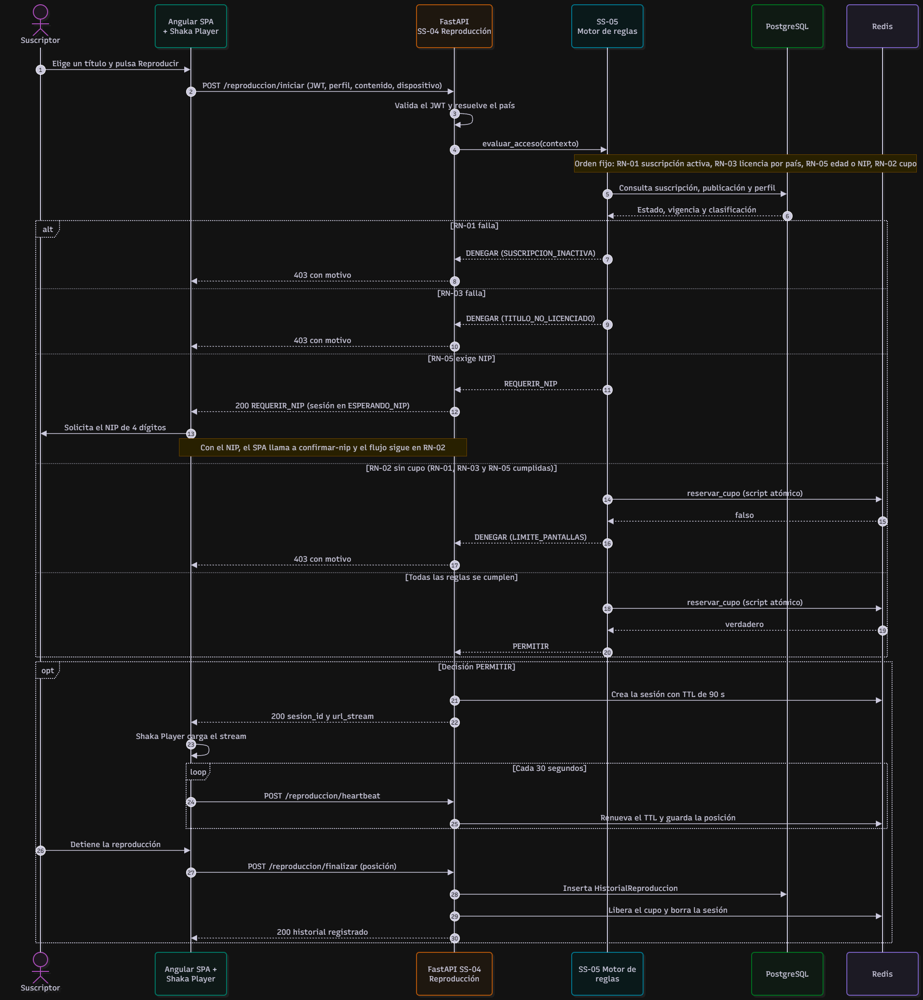
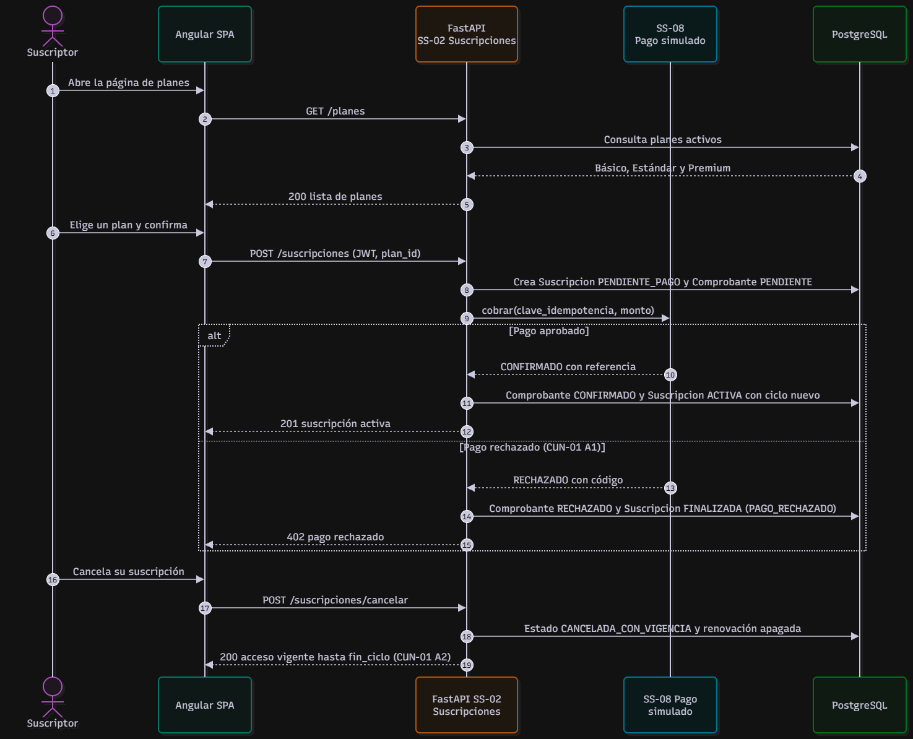
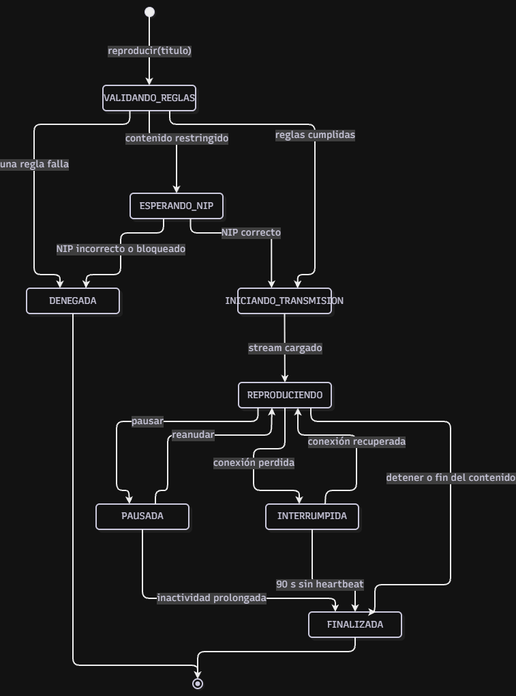

# Plataforma de Streaming de Video — Equipo 4 (SCRUM)

MVP desarrollado bajo metodología SCRUM para la asignatura **Métodos de Desarrollo de Software** (Universidad del Caribe), trazado a la arquitectura modular definida en el RUP.

## Equipo y Roles SCRUM

| Integrante | Rol SCRUM | Rol Técnico | Subsistemas RUP |
| :--- | :--- | :--- | :--- |
| **Abigail Hernández Contreras** | Scrum Master | Backend (Identidad) & DevOps | Infraestructura + `SS-01` |
| **Braiam Augusto Hernandez Cen** | Product Owner | Backend (Motor de Reglas y Redis) | `SS-05` (`RN-01` a `RN-05`) |
| **Jorge Enrique Soberanes Espinosa** | Development Team | Backend (Suscripciones) & QA | `SS-02` (`CUN-01`) |
| **Diego Ángel Vázquez Contreras** | Development Team | Backend (Catálogo) & Base de Datos | `SS-03` (`RN-03`) |
| **Alondra Lissette García García** | Development Team | Frontend Angular (Cuentas y Planes) | `SS-01` (`RN-05`) + `SS-02` |
| **Emily Ashanty May Alemán** | Development Team | Frontend Angular & Shaka Player | `SS-04` (`CUN-02`) |
| **Melina Alejandra Yáñez Rodríguez** | Development Team | UX/UI Figma & Frontend Admin | `SS-06` (`CUN-03`) + `SS-07` |

---

## Acceso a la API y Despliegue (MVP)

### Entorno Compartido en Vivo (Dev Tunnel)
Durante las sesiones de desarrollo, integración con frontend y revisiones de Sprint, la API está disponible en línea en:
* **Documentación interactiva (Swagger UI):** [https://72q923p4-8000.usw3.devtunnels.ms/docs](https://72q923p4-8000.usw3.devtunnels.ms/docs)
* **Verificación de estado (Healthcheck):** [https://72q923p4-8000.usw3.devtunnels.ms/health](https://72q923p4-8000.usw3.devtunnels.ms/health)

*(Nota: Al abrir el enlace por primera vez en el navegador, haz clic en **Continue** en la pantalla de aviso de VS Code Dev Tunnels).*

### Ejecución Local con Docker Compose
Para levantar la base de datos PostgreSQL, Redis y el backend FastAPI en cualquier equipo local, ejecuta desde la raíz del repositorio:

    docker compose up --build -d

Una vez iniciados los contenedores, accede de forma local en:
* **Swagger UI:** `http://localhost:8000/docs`
* **Healthcheck:** `http://localhost:8000/health`

### Cuentas Semilla y Datos de Prueba
Al inicializar el volumen de PostgreSQL se cargan automáticamente los 3 planes comerciales (`Básico`, `Estándar`, `Premium`), el catálogo multi-región (`MX` y `US`) y las siguientes cuentas de prueba (contraseña universal: **`Demo1234!`**):

| Correo | Contraseña | País | Rol | Configuración inicial |
| :--- | :--- | :---: | :--- | :--- |
| `suscriptor@equipo4.mx` | `Demo1234!` | `MX` | `SUSCRIPTOR` | Plan Estándar (2 pantallas), perfil Adulto e Infantil (NIP: `1234`) |
| `usuario.us@equipo4.com` | `Demo1234!` | `US` | `SUSCRIPTOR` | Plan Básico (1 pantalla), catálogo licenciado en EE. UU. (`RN-03`) |
| `admin@equipo4.mx` | `Demo1234!` | `MX` | `ADMIN` | Cuenta editorial para gestión de catálogo (`SS-06` / `SS-07`) |

---

## Diagramas de Arquitectura y Diseño (MVP)

Los archivos híbridos (imagen y fuente editable para draw.io) se encuentran en [`docs/diagramas/`](docs/diagramas/).

### 1. Arquitectura y Despliegue (Docker Compose)

### 2. Modelo Entidad-Relación (PostgreSQL)

### 3. Secuencia de Reproducción y Reglas de Acceso (`CUN-02`)

### 4. Secuencia de Contratación y Cancelación (`CUN-01`)

### 5. Máquina de Estados de Suscripción

### 6. Máquina de Estados de Sesión de Reproducción

---