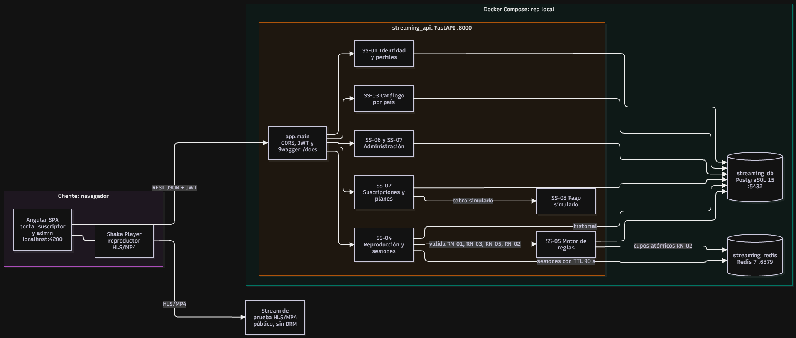
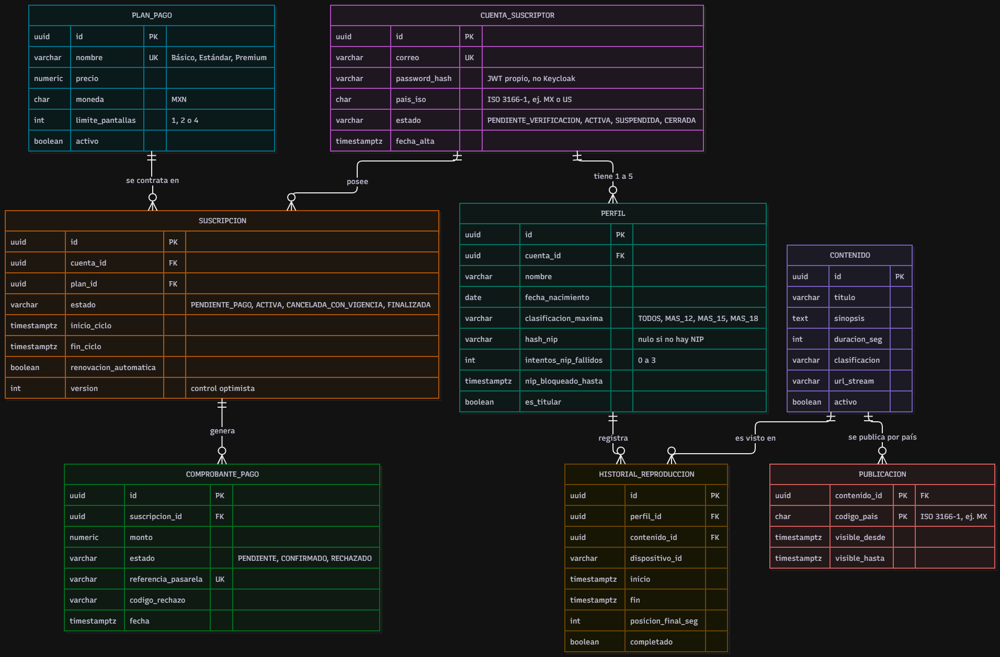
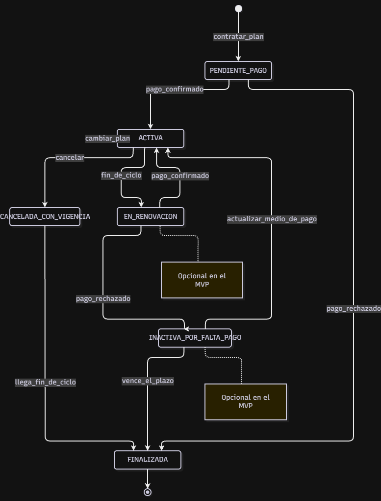

# Plataforma de Streaming de Video — Equipo 4 (SCRUM)

MVP desarrollado bajo metodología SCRUM para la asignatura **Métodos de Desarrollo de Software** (Universidad del Caribe), trazado a la arquitectura modular definida en el RUP.

## Equipo y Roles SCRUM

| Integrante | Rol SCRUM | Rol Técnico | Subsistemas RUP |
| :--- | :--- | :--- | :--- |
| **Abigail Hernández Contreras** | Scrum Master | Backend (Identidad) & DevOps | Infraestructura + `SS-01` |
| **Braiam Augusto Hernandez Cen** | Product Owner | Backend (Motor de Reglas y Redis) | `SS-05` (`RN-01` a `RN-05`) |
| **Jorge Enrique Soberanes Espinosa** | Development Team | Backend (Suscripciones) & QA | `SS-02` (`CUN-01`) |
| **Diego Ángel Vázquez Contreras** | Development Team | Backend (Catálogo) & Base de Datos | `SS-03` (`RN-03`) |
| **Alondra Lissette García García** | Development Team | Frontend Angular (Cuentas y Planes) | `SS-01` (`RN-05`) + `SS-02` |
| **Emily Ashanty May Alemán** | Development Team | Frontend Angular & Shaka Player | `SS-04` (`CUN-02`) |
| **Melina Alejandra Yáñez Rodríguez** | Development Team | UX/UI Figma & Frontend Admin | `SS-06` (`CUN-03`) + `SS-07` |

---

## Diagramas de Arquitectura y Diseño (MVP)

Los archivos híbridos (imagen y fuente editable para draw.io) se encuentran en [`docs/diagramas/`](docs/diagramas/).

### 1. Arquitectura y Despliegue (Docker Compose)

### 2. Modelo Entidad-Relación (PostgreSQL)

### 3. Secuencia de Reproducción y Reglas de Acceso (`CUN-02`)

### 4. Secuencia de Contratación y Cancelación (`CUN-01`)

### 5. Máquina de Estados de Suscripción

### 6. Máquina de Estados de Sesión de Reproducción
